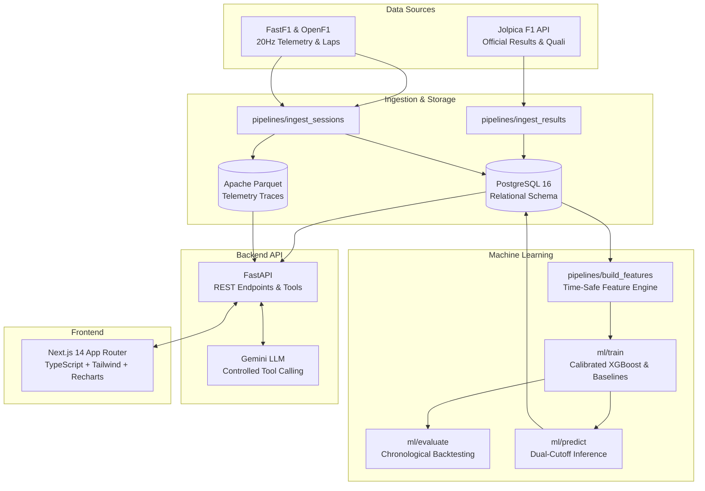

# F1 Race Intelligence — Architecture & System Design

## 1. System Overview

F1 Race Intelligence is a production-grade full-stack intelligence platform built with three interconnected modules:
1. **Race Weekend Intelligence**: Multi-cutoff podium probability prediction (pre-weekend vs. post-qualifying) with feature attribution and calibration metrics.
2. **Race Dashboard & Telemetry Duel**: Multi-session analysis featuring lap position evolution, tyre compound pace & degradation modeling, plus distance-interpolated 20Hz telemetry comparison between two drivers.
3. **F1 Data Assistant**: Tool-augmented conversational assistant querying validated application databases without hallucinating unsupported telemetry.



## 2. Directory Layout

```
f1_race_intel/
├── apps/
│   ├── api/                  # FastAPI backend
│   │   ├── alembic/          # DB migrations
│   │   ├── routers/          # races, sessions, telemetry, predictions, chat
│   │   ├── config.py
│   │   ├── database.py
│   │   ├── models.py
│   │   ├── schemas.py
│   │   └── main.py
│   └── web/                  # Next.js 14 frontend
│       ├── src/app/          # App router pages (races, telemetry, predictor, assistant, methodology)
│       ├── src/components/   # Recharts charts, navbar, UI components
│       └── src/lib/          # API client, lap time formatting, color maps
├── pipelines/
│   ├── ingest_results/       # Jolpica client, normalizer, loader, quality checks
│   ├── ingest_sessions/      # FastF1 client, telemetry processor, session loader
│   └── build_features/       # Time-safe feature engineering
├── ml/
│   ├── train/                # Baselines, logistic regression, XGBoost, training CLI
│   ├── evaluate/             # Chronological split, rolling backtests, Brier score
│   └── predict/              # Predictor inference and DB persistence
├── shared/
│   └── schemas/              # Pydantic v2 domain schemas
├── data/
│   ├── samples/              # Test fixtures and reproducible sample JSON
│   └── parquet/              # Clean 20Hz car telemetry Parquet assets
├── tests/                    # Pytest test suite (16 tests passing)
├── docs/                     # Technical architecture and user guides
├── docker-compose.yml        # Multi-container orchestration (Postgres, API, Web)
└── .env.example
```
